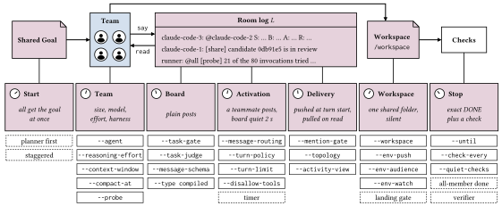

# Harness modules

`goal run` has a fixed core and seven modules. The core is what every run needs: one container
per Agent with a private home, the image, the network (`--isolate`, `--web-search`,
`--model-api`), the sign-ins, the turn loop and the run record (`--out`, `--name`). A module is
one decision about how the team works together, with a reference setting and options that
change it. Six of the modules are the ones the DRAC technical report names (Team, Start,
Activation, Delivery, Board, Stop); Workspace is added here because how work lands is a decision
of the same kind.

<picture>
  <source media="(prefers-color-scheme: dark)" srcset="assets/sharednet-modules-dark.svg">
  
</picture>

The top row is what a run is made of. Under each part is the module that configures it, its
reference setting in italics, and its `goal run` options. A dashed entry is an alternative the
report studied that has no option yet.

A run that sets no option runs with the reference settings, which is how `goal run` behaved
before any of these options existed. A run records what it used in `episode.json`.

## The modules

| Module | Decides | Reference setting | Options |
| --- | --- | --- | --- |
| Team | who is on the team | the seats you name, one model each | `--agent` (once per seat), `--reasoning-effort`, `--context-window`, `--compact-at`, `--probe` + `--probe-every` |
| Start | how the goal reaches the team | every seat gets the goal at once | none yet |
| Activation | what resumes a seat, and when its turn ends | a teammate's post resumes every idle seat once the board has been quiet for 2 s | `--message-routing`, `--turn-policy`, `--turn-limit`, `--disallow-tools` |
| Delivery | which posts a resumed seat is given, and what else comes with them | everything new at the start of the turn; more on `sharednet read` | `--mention-gate`, `--topology`, `--activity-view` |
| Board | what a post is, and what a seat may publish | plain posts | `--task-gate`, `--task-judge`, `--message-schema`, `--type compiled` |
| Stop | when the run ends | the first `--until` trigger to fire | `--until`, `--check-every`, `--quiet-checks` |
| Workspace | where work lands, and what the workspace tells the seats | one shared `/workspace` that every seat writes to, and says nothing | `--workspace`, `--env-push`, `--env-audience`, `--env-watch` |

Options marked new below came with the modules; the others were there before and are listed so
that every option has one place.

### Team

- `--agent <harness>:<model>`, once per seat, with `--reasoning-effort`, `--context-window` and
  `--compact-at` for the seats' models.
- New: `--probe <command> --probe-every 5m` adds a participant with no model behind it. The
  runner runs the command on a fixed clock in the checks container, on the shared workspace, and
  posts what it prints as a `[probe]` line to `@all`. Empty output posts nothing; each run is
  logged in `probe.ndjson`. A probe is a source of information, not a judge: a differential
  tester against a reference, a coverage count.

Not yet: adding or retiring a seat during a run, roles.

### Start

`goal run` has one way to start: every seat receives the goal in its first turn. The planner-first
and staggered starts of the report have no option yet.

### Activation

- `--message-routing broadcast|mentions|mentions-only`: whom a post resumes. With
  `mentions-only`, a post that names nobody resumes nobody.
- `--turn-policy cooperative-v1`: every wake ends by asking the seat to finish one bounded piece
  of work, publish it and end its turn, without polling or waiting.
- `--turn-limit <duration>`: the longest a turn may run.
- New: `--disallow-tools <Tool,Tool>` withholds the named tools from Claude Code seats. Its use
  here is `ScheduleWakeup`: a seat that schedules its own wake stays inside its turn until then,
  and the runner cannot resume a seat that is in a turn. See [goal-mode.md](goal-mode.md).

Not yet: resuming seats on a timer.

### Delivery

- `--mention-gate`: addressed delivery. If posts that name a seat are waiting unseen when it
  tries to post, its post is held back, it is given those posts, and it posts again or revises.
  It also makes `mentions` the default routing.
- New: `--topology islands:<K>` deals the seats round-robin into K islands. A post reaches the
  sender's own island and crosses to the others only when it names someone there with `@name` or
  starts with `[share]`. Lines from the runner reach everyone, and the Room's history stays
  whole: `sharednet read` still shows every post.
- New: `--activity-view` ends every wake with who is in a turn, who is idle and who holds which
  task, from the runner's own record of turns and from the task acts, not from what anyone said.

Not yet: neighbourhood or small-world graphs, summaries in place of posts.

### Board

- `--task-gate`: a seat claims a task on the board before it works; claims and completions resume
  nobody. It currently locks Claude Code seats out: the shell guard reads
  `BASH_EXECUTION_STRING`, which under Claude Code is its own wrapper, so the claim itself is
  refused.
- New: `--task-judge lexical` refuses a claim whose title is close to a task another seat holds,
  naming that task and its owner, before anything is posted. The claimant takes other work or
  claims again with `--distinct "<how yours differs>"`. Closeness is the share of the shorter
  title's content words that the other has too, from 0.6 on.
- New: `--message-schema sbar`: a post that names a teammate (other than `@all`) is a handoff and
  must carry `S:` situation, `B:` background, `A:` assessment and `R:` recommendation.
  `sharednet say` refuses one without them and shows the template. Every wake then lists what has
  been asked of the woken seat: the `R:` part of each handoff to it.
- `--type compiled`: a Room with the typed work protocol of `src/protocol/` in place of a board.

### Stop

`--until` holds the end of the run and can be given several times; the first to fire ends it:
`check: <command>`, `said: DONE`, `after: 30m`, `budget: 2M tokens`. `--check-every` sets how often the check runs and `--quiet-checks` keeps its results
out of the Room. The all-member and verifier stops of the report have no option yet.

### Workspace

`--workspace` names the folder every seat shares. Nothing stands between a seat and that folder,
and by default nothing tells a seat that a file changed under it.

- New: `--env-push on-wake|on-event|on-action` makes the workspace a participant. The runner
  scans it every five seconds, with no model behind it. For each seat it keeps the files the
  seat's turns have named, in a command or in what a command printed, read from the folder the
  seat's shell was standing in (many files in one command's output are a listing, not a reading
  of each). When a file a seat has an interest in is changed by someone else, the seat is told
  which file, who changed it, and in which turn it last had the file. The author is the seat
  that had a command running at the moment the file was written; with several running, the one
  whose command named the file, or else the one whose shell stood in a folder that holds it (git
  and build scripts name no files; a command that changes folder is in each folder it passes
  through, and a here-document's text is not read as the command); otherwise the note names the
  seats that were working. A file a
  seat only read stops being its concern after six of its turns; a file it changed stays its
  own. The levels add up, each one a time at which the seat is told:
  - `on-wake`: with its next wake, whatever caused the wake.
  - `on-event`: also by a line from the runner, `@seat [env] …`, once the change has rested for
    15 s. The line resumes that seat when it is idle and no other seat, whatever the routing, and
    a seat gets at most one every two minutes.
  - `on-action`: also inside a Claude Code seat's turn, through a hook. A write to a file that
    changed under the seat (an edit tool on it, or a shell command that names it and redirects
    into a file, edits in place, or has git rewrite the tree; output thrown away to `/dev/null`
    is not a write) is held once: nothing is written, and the
    seat is told who changed the file. Other changes arrive after its next tool call. Seats of
    other harnesses are told as with `on-event`.
- `--env-audience all` tells every other seat about every change, new files included. The
  default, `affected`, tells only the seats with an interest in the file.
- `--env-watch <folder>:<path in the containers>` adds a folder that is mounted into the seats
  beside the workspace. It can be given more than once. Such a folder is taken to be shared:
  where each seat works on its own copy of the files and lands into the shared one, a seat is
  told when a shared file changes and no longer matches the copy it holds (the same path under
  another folder, compared byte for byte), so the seat whose copy was just landed is not told.

Every change and every delivery is logged in `environment.ndjson`: what changed, who was in a
turn, who was told, and how (`wake`, `post`, `note`, `held-edit`). The option changes Delivery
(what a seat is given) and Activation (an `[env]` line resumes an idle seat); it is listed here
because the workspace is what speaks.

Not yet: other layouts than one shared folder (a fork of the workspace that a seat merges back,
or no shared folder at all and only a shared repository that each seat clones and lands into), a
landing gate (a candidate is accepted only if a measure does not fall; tools built on `goal run`
add their own), a note that says what a landing means for a seat's own copy, a model that says
what a change means for the seat, and state that is not files.

## Presets

`--harness-mode` names a frozen combination. The new options cannot be combined with one yet.

| Preset | Changes |
| --- | --- |
| `research/baseline@1` | nothing |
| `research/routing-only@1` | Activation: routing `mentions` |
| `research/receipt-only@1` | Delivery: mention gate, routing stays `broadcast` |
| `research/mentions@1` | Activation and Delivery |
| `research/tasks@1` | Board: task gate |
| `research/both@1` | Activation, Delivery and Board |
| `research/single@1` | Team: one seat |

## Where the code is

The new options live in `packages/cli/src/modules/`, one file per research area they came from,
with `index.ts` holding their defaults, the run record and the environment a seat's own
`sharednet` needs.

| File | Options | Module |
| --- | --- | --- |
| `state.ts` | `--task-judge`, `--activity-view` | Board, Delivery |
| `topology.ts` | `--topology` | Delivery |
| `protocol.ts` | `--message-schema` | Board |
| `information.ts` | `--probe` | Team |
| `environment.ts` | `--env-push`, `--env-audience`, `--env-watch` | Workspace |

## Rules for adding an option

1. The reference setting stays the behaviour before the change; new behaviour is opt-in.
2. An option belongs to one module. If it changes two, name the one it is for and say so here.
3. An experiment changes one module at a time and records it in `episode.json`.
4. Protocol definitions belong to the research repository; this repository implements them.
